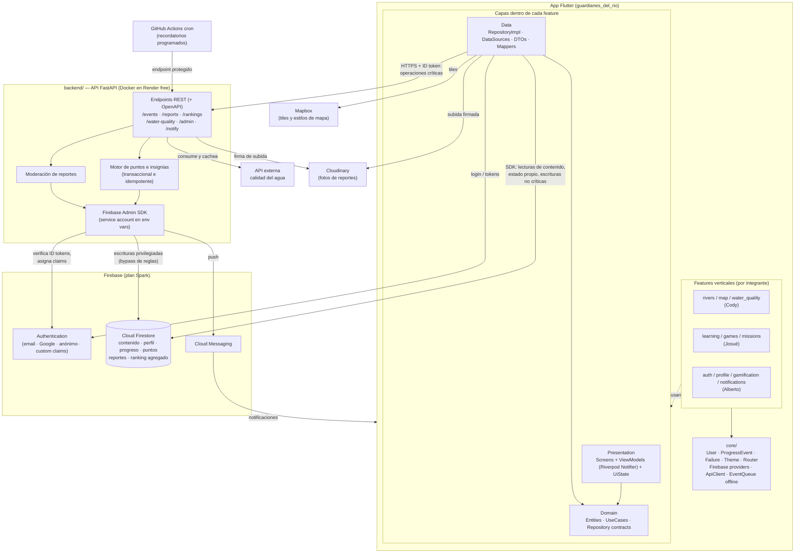

# ARCHITECTURE.md — Guardianes del Río

> Documento de arquitectura técnica. Cubre el análisis arquitectónico (Entregable 1) y la arquitectura lógica (Entregable 2).
> Las decisiones individuales están registradas como ADRs en [docs/adr/](../adr/).

---

## 1. Análisis arquitectónico

### 1.1 Necesidades que condicionan la arquitectura

| Necesidad | Origen | Consecuencia arquitectónica |
|---|---|---|
| App educativa para niños/jóvenes, Android prioritario | RNF-01, RNF-04 | Flutter con un solo código base; rendimiento en gama básica |
| 3 desarrolladores con módulos verticales completos | Reparto.md | Feature-first: cada módulo contiene sus 3 capas; núcleo compartido mínimo |
| Puntos/insignias no manipulables desde el cliente | Regla 8, F2.2 | Lógica de puntuación exclusivamente en servidor (API Python + Admin SDK) |
| Datos de menores de edad | RNF-07, Entregable 6 | Reglas deny-by-default, ranking seudonimizado, consentimientos, LOPDP |
| Modo offline (contenido, trivias, sincronización de progreso) | RNF-02, F4.2 | Firestore con persistencia offline + cola local de eventos con IDs deterministas |
| Contenido administrable sin republicar la app | RNF-09 | Contenido (ríos, lecciones, misiones) como datos en Firestore, no hardcodeado |
| Presupuesto cero: plan **Spark** de Firebase | Decisión del equipo | Sin Cloud Functions ni Firebase Storage → API FastAPI en hosting gratuito externo + Cloudinary |
| Calidad del agua desde API externa | Decisión del equipo | Solo consumo, abstraído tras `WaterQualityRepository`; no se desarrolla ingesta de sensores |

### 1.2 Por qué Clean Architecture + MVVM

- **Clean Architecture** separa *qué hace la app* (Domain) de *cómo lo hace* (Data/Firebase/API). Esto permite: (a) testear la lógica sin Firebase, (b) cambiar una fuente de datos (ej. la API de calidad del agua) sin tocar pantallas, y (c) que las 15 reglas obligatorias sean verificables leyendo imports.
- **MVVM** resuelve la capa de presentación: la View es declarativa y tonta, el ViewModel orquesta casos de uso y expone estado observable. En Flutter + Riverpod el ViewModel es un `Notifier`/`AsyncNotifier` y el estado se consume con `ref.watch`.
- **Cómo se relacionan sin confundirse**: MVVM vive *dentro* de la capa Presentation de Clean Architecture. El ViewModel no es el dueño de la lógica de negocio: la delega a los Use Cases de Domain. El ViewModel solo traduce intenciones del usuario a casos de uso y resultados a estado de UI.

```
View (Widget) ──watch──▶ ViewModel (Notifier) ──▶ UseCase ──▶ Repository (contrato)
                                                                      ▲ implementa
                                                             RepositoryImpl ──▶ DataSources (Firebase SDK / API HTTP / local)
```

### 1.3 División vertical por funcionalidades

Cada feature (`rivers`, `learning`, `gamification`, …) contiene sus propias subcarpetas `presentation/`, `domain/`, `data/`. Un integrante es dueño de sus features de punta a punta. Lo único compartido vive en `lib/core/` y tiene una sola fuente de verdad (regla 7):

**Pertenece al núcleo compartido (`core/`)**
- Entidades transversales: `User`, `Progress`, `ProgressEvent`, `UserPoints` (solo lectura para los módulos que no son dueños).
- Contratos de eventos de progreso (el "idioma" entre módulos).
- Theme/design system (F0.2), router/navegación (F0.5), manejo de errores (`Failure`), cliente HTTP autenticado hacia la API, providers de Firebase.

**Pertenece a cada feature**
- Sus entidades propias (`River`, `Lesson`, `Badge`…), sus contratos de repositorio, sus casos de uso, sus pantallas y ViewModels, sus data sources.

**Regla de comunicación entre módulos**: un módulo nunca importa `features/otro_modulo/data/...` ni `.../presentation/...`. Si necesita algo de otro módulo, lo consume vía (a) un contrato expuesto en `core/`, o (b) eventos de progreso procesados por el servidor. Ejemplo: Gamificación (Alberto) no llama al código de Lecciones (Josué); reacciona a los eventos `LeccionCompletada` que el servidor procesa.

### 1.4 Responsabilidades de Firebase (plan Spark)

| Servicio | Uso | Nota Spark |
|---|---|---|
| **Firestore** | Base de datos única: contenido (ríos, sectores, lecciones, preguntas, misiones), estado de usuario (perfil, progreso, puntos, insignias), reportes, ranking agregado | Persistencia offline incluida; reglas de seguridad por colección |
| **Authentication** | Registro/login (email, Google) y modo invitado (anónimo); roles vía custom claims | Los claims los asigna la API Python con Admin SDK |
| **Cloud Messaging (FCM)** | Notificaciones push (F4.1) | El *envío* lo hace la API Python; los recordatorios programados los dispara un cron externo gratuito (GitHub Actions schedule → endpoint protegido) |
| ~~Cloud Functions~~ | **No disponible en Spark** | Sustituido por la API FastAPI (ADR-0004) |
| ~~Storage~~ | **No disponible en Spark** (buckets nuevos requieren Blaze desde oct-2024) | Sustituido por Cloudinary para fotos de usuario y assets/URLs para contenido editorial (ADR-0008) |

**Patrón de acceso a datos:**
- **Lecturas de contenido y del propio estado** → el cliente lee Firestore directamente con el SDK (gratis, rápido, offline). Siempre a través de un DataSource, nunca desde un ViewModel.
- **Escrituras no críticas del propio usuario** (perfil, avatar) → SDK directo, validado por reglas.
- **Toda operación crítica** (eventos de progreso, puntos, insignias, reportes, moderación, ranking) → **pasa por la API Python**. Las reglas de Firestore niegan estas escrituras al cliente.

### 1.5 Responsabilidades de Python (FastAPI)

Una sola API FastAPI (`backend/`), desplegada como contenedor Docker en el free tier de Render (portable a Railway/Fly/PythonAnywhere). Se comunica con Firebase mediante **Firebase Admin SDK** y una service account guardada en variables de entorno del hosting.

Responsabilidades (y nada más — regla 11, no duplicar lógica con el cliente):

1. **Motor de puntos y reglas (F2.2)**: recibe eventos de progreso, los valida, otorga puntos/insignias/niveles en transacción. Idempotente (ver §3).
2. **Verificación de identidad**: cada endpoint exige el ID token de Firebase; la API lo verifica con Admin SDK y extrae `uid` + rol.
3. **Ranking (F3.3)**: agrega y publica el ranking seudonimizado.
4. **Reportes ciudadanos (RF-07)**: creación con foto (subida firmada a Cloudinary), moderación y cambio de estado.
5. **Proxy/caché de calidad del agua**: consume la API externa, normaliza al contrato `WaterQualityMeasurement` y cachea en Firestore para que la app lea offline.
6. **Notificaciones**: envío FCM y endpoints de recordatorio invocados por cron externo.
7. **Administración**: asignación de roles (custom claims), carga de contenido para el panel (F1.5).

FastAPI genera automáticamente la especificación **OpenAPI** (`/docs`), que cumple el criterio de F0.4.

### 1.6 Riesgos y decisiones pendientes

| Riesgo / pendiente | Impacto | Mitigación |
|---|---|---|
| **Cold start del free tier de Render** (~30–60 s tras 15 min sin tráfico) | Primer `POST /events` del día puede tardar | (a) Cola local con reintento: el evento no se pierde y la UI no bloquea (optimistic UI); (b) el cron de notificaciones ya "despierta" la API periódicamente; (c) migrar a instancia paga o a Blaze+Functions es un cambio solo de despliegue, no de arquitectura |
| **API externa de calidad del agua no confirmada** | El módulo de Cody podría quedarse sin fuente | El contrato `WaterQualityRepository` se programa contra un `FakeWaterQualityDataSource` con datos del periódico (índice ilustrativo, RNF: marcar dato como oficial/estimado/editorial). Si la API existe, solo se implementa el DataSource real |
| Cuotas Spark (50k lecturas/día Firestore) | Suficiente para piloto; riesgo si se usa en aulas masivamente | Modelar lecturas con documentos agregados (ej. ranking en 1 doc), caché offline agresiva |
| Límite de FCM/cron para alertas de crecidas (RF-10, F2) | Fase 2, no bloquea MVP | Diseñado pero no implementado en v1 |
| Panel web administrativo (RF admin) | No está en el alcance móvil | v1: carga por scripts Python + endpoints admin de la API; panel web es fase posterior |
| Contenido del río Punzara (observación §6 de requerimientos) | Decisión editorial, no técnica | El modelo de datos soporta N ríos; decidir con el equipo |

---

## 2. Arquitectura lógica

### 2.1 Diagrama



Dependencias reales que el diagrama refleja (y las que **no** existen):
- Los ViewModels **no** tocan Firebase ni HTTP: solo la capa Data lo hace (reglas 1 y 14).
- La app **nunca** escribe puntos/eventos/ranking en Firestore: solo la API vía Admin SDK (regla 8).
- La API **no** sirve el contenido de lectura (eso sería duplicar a Firestore, regla 11): el cliente lee contenido directo del SDK.
- La API externa de calidad del agua solo la conoce el backend; la app consume el dato ya normalizado/cacheado.

### 2.2 Flujos clave

**Flujo A — Leer contenido (ficha de río):**
`RiverScreen` → `riverListProvider (ViewModel)` → `GetRiversUseCase` → `RiverRepository` → `RiverRepositoryImpl` → `FirebaseRiverDataSource` (SDK Firestore, con caché offline) → mapper DTO→Entity → estado `AsyncValue<List<River>>` en la UI.

**Flujo B — Completar una lección (evento crítico):**
1. `LessonViewModel` llama `CompleteLessonUseCase`.
2. El use case construye un `ProgressEvent` con **ID determinista** `{uid}_{lessonId}_lesson_completed` y lo entrega a `ProgressRepository`.
3. `ProgressRepositoryImpl` lo encola en la **cola local** (soporte offline) y la cola lo envía: `POST /events` con el ID token.
4. La API verifica token → transacción Firestore: crea `progress_events/{id}` (si ya existe → 200 sin efectos), actualiza `progress`, `user_points`, evalúa insignias → responde con puntos otorgados.
5. El cliente observa `user_points` (listener Firestore, solo lectura) y la UI se actualiza.

**Flujo C — Reporte de contaminación:**
App pide a la API una firma de subida → sube la foto a Cloudinary → `POST /reports` con URL + ubicación + categoría → la API crea el reporte en estado `recibido` → tras moderación (`PATCH /admin/reports/{id}`) pasa a `aprobado` y aparece en la capa de reportes del mapa.

### 2.3 Transversales

| Aspecto | Decisión |
|---|---|
| **Errores** | Jerarquía `Failure` sellada en `core/error/` (`NetworkFailure`, `AuthFailure`, `ValidationFailure`, `ServerFailure`). Los DataSources lanzan excepciones; los RepositoryImpl las convierten a `Failure`; los ViewModels exponen `AsyncValue.error(failure)` |
| **Estados de UI** | `AsyncValue<T>` de Riverpod (loading/data/error) como forma estándar; estados de pantalla complejos como clases selladas por feature |
| **Inyección de dependencias** | Providers de Riverpod: cada contrato tiene un provider (`riverRepositoryProvider`) que en tests se sobreescribe con fakes. Sin librería de DI adicional |
| **Validaciones** | De formato en Domain (entidades/use cases); de negocio y permisos **siempre** en servidor (API + reglas Firestore) |
| **Configuración por ambientes** | Flavors `dev`/`prod` → dos proyectos Firebase; `--dart-define` para `API_BASE_URL`, `MAPBOX_TOKEN`; en backend, variables de entorno por ambiente |
| **Logging** | App: `logger` con niveles, sin datos personales en logs. API: logging estructurado de FastAPI/uvicorn; errores con request-id |
| **Seguridad** | Ver [SECURITY.md](SECURITY.md) |
| **Pruebas** | Ver [TESTING_DEPLOYMENT.md](TESTING_DEPLOYMENT.md) |

---

## 3. Idempotencia y consistencia de puntos (detalle normativo)

- Todo evento tiene ID determinista: `{uid}_{objectId}_{eventType}` (+ sufijo de fecha `yyyymmdd` para eventos repetibles por día, ej. racha o misión diaria).
- La API procesa el evento en **una transacción** Firestore: `create` del documento evento (falla si existe) + incrementos de puntos + progreso. Documento existente ⇒ evento ya procesado ⇒ respuesta OK sin re-otorgar.
- Reenviar un evento (reintento offline, doble tap, replay malicioso) es por tanto inocuo (criterio de F2.2: "los puntos son consistentes aunque se repita un evento").
- Los valores de puntos los decide **solo** el servidor según `eventType` (tabla de reglas en el backend). El cliente jamás envía "cuántos puntos".

## 4. Mapeo con las fases del plan (orden anti-bloqueo)

1. **F0.4 es el desbloqueador crítico**: con `core/` (entidades compartidas + contratos de eventos) y este documento aprobados, cada integrante programa contra fakes sin esperar a nadie.
2. **F0.3 (Auth)** antes que cualquier operación crítica: la API necesita ID tokens.
3. La cadena **F2.1 (eventos, Josué) → F2.2 (puntos, Alberto)** queda desacoplada por contrato: Alberto implementa el motor contra el *esquema del evento* ([API_CONTRACTS.md](API_CONTRACTS.md)), no contra el código de Josué.
4. El mapa (F1.2) depende del catálogo (F1.1) solo por datos, no por código: Cody puede desarrollar ambos con seeds locales.

## 5. Documentos relacionados

- [PROJECT_STRUCTURE.md](PROJECT_STRUCTURE.md) — estructura de carpetas y ubicación de cada pieza.
- [DATA_MODEL.md](DATA_MODEL.md) — entidades y colecciones Firestore.
- [API_CONTRACTS.md](API_CONTRACTS.md) — contratos, eventos y endpoints.
- [SECURITY.md](SECURITY.md) — seguridad y privacidad de menores.
- [TESTING_DEPLOYMENT.md](TESTING_DEPLOYMENT.md) — pruebas y despliegue.
- [../adr/](../adr/) — registro de decisiones.
