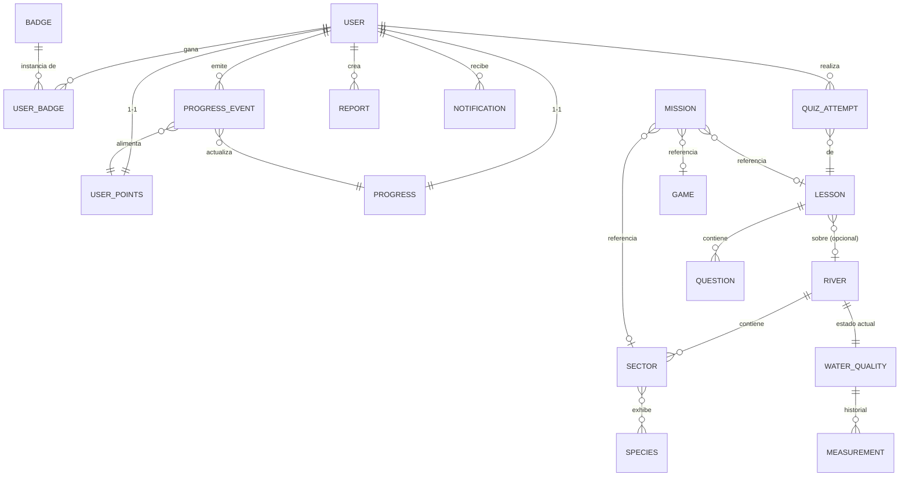

# DATA_MODEL.md — Modelo de datos

> Entregable 4. Entidades de dominio, relaciones y persistencia en Firestore.
> Convención: las **entidades de dominio** (Dart, `domain/entities/`) son clases inmutables sin nada de Firebase; los **modelos de persistencia** (DTOs, `data/models/`) saben serializarse de/hacia Firestore o JSON de la API y se convierten con mappers. El backend usa modelos Pydantic equivalentes.

## 0. Mapa de colecciones Firestore

```
users/{uid}                          # Perfil (datos mínimos)
rivers/{riverId}                     # Catálogo de ríos
rivers/{riverId}/sectors/{sectorId}  # Sectores/puntos por río (Zona → Sector)
species/{speciesId}                  # Atlas de flora y fauna (referenciado por sector)
water_quality/{riverId}              # Último estado por río (caché del backend)
water_quality/{riverId}/history/{measurementId}
lessons/{lessonId}                   # Lección con steps embebidos
lessons/{lessonId}/questions/{questionId}
games/{gameId}                       # Metadatos de minijuegos
missions/{missionId}                 # Misiones diarias/semanales/especiales
badges/{badgeId}                     # Catálogo de insignias y reglas de desbloqueo
progress_events/{eventId}            # SOLO backend escribe (ID determinista)
progress/{uid}                       # Resumen de progreso por usuario
progress/{uid}/items/{itemId}        # Detalle por lección/quiz/juego/misión
user_points/{uid}                    # Saldo, nivel, racha (SOLO backend escribe)
user_badges/{uid}/badges/{badgeId}   # Insignias obtenidas (SOLO backend escribe)
quiz_attempts/{attemptId}            # Intentos de quiz (escribe backend al procesar evento)
rankings/{scope}                     # Documento agregado por ámbito (global, aula...)
reports/{reportId}                   # Reportes ciudadanos (crea backend; estados)
notifications/{uid}/items/{notifId}  # Bandeja de notificaciones del usuario
```

## 1. Entidades

Formato: **Responsabilidad · Atributos · ID · Relaciones · Persistencia · Validaciones**.

### User
- **Responsabilidad:** identidad y datos mínimos del usuario (principio de minimización: es una app de menores).
- **Atributos:** `uid`, `displayName` (alias, no nombre legal), `avatarId`, `ageRange` (`child`/`teen`/`adult`, nunca fecha de nacimiento), `role` (`child`|`teacher`|`parent`|`admin`), `neighborhoodId?` (opcional), `classroomId?`, `createdAt`.
- **ID:** `uid` de Firebase Auth.
- **Relaciones:** 1–1 con `UserPoints` y `Progress`; 1–N con `UserBadge`, `Report`, `Notification`.
- **Persistencia:** `users/{uid}`. El rol vive en custom claims (fuente de verdad para autorización) y se copia aquí solo para UI.
- **Validaciones:** `displayName` 3–20 caracteres sin apellidos sugeridos; `avatarId` debe existir en el catálogo; el cliente solo puede modificar `displayName`, `avatarId`, `neighborhoodId`.

### River
- **Responsabilidad:** ficha de un río (Malacatos, Zamora, Jipiro…).
- **Atributos:** `id`, `name`, `shortDescription`, `history`, `imageUrls[]`, `geometry` (polyline GeoJSON simplificada), `status` (`healthy`|`moderate`|`atRisk`), `statusSource` (`official`|`estimated`|`editorial`), `order`.
- **ID:** slug (`malacatos`).
- **Relaciones:** 1–N `Sector/PointOfInterest`; 1–1 `WaterQualityState`.
- **Persistencia:** `rivers/{riverId}`. `status` denormalizado aquí (lo actualiza el backend al refrescar calidad) — justificación: la pantalla de inicio lista ríos con semáforo en 1 lectura.
- **Validaciones:** solo admin escribe; `statusSource` obligatorio (observación §6.3 de requerimientos).

### Sector / PointOfInterest
- **Responsabilidad:** sector urbano o punto de interés sobre el río (los 12 sectores del periódico: Capulí II…Sauces Norte II).
- **Atributos:** `id`, `riverId`, `zone` (`south`|`center`|`north`), `name`, `description`, `location` (lat/lng), `history`, `problems[]`, `waterRelation`, `testimonies[]` (`{author, quote}`), `funFacts[]`, `speciesIds[]`, `imageUrls[]`, `layers` (flags: flood/pollution/landslide…).
- **ID:** slug (`capuli-ii`).
- **Relaciones:** N–1 `River`; N–N `Species`.
- **Persistencia:** subcolección `rivers/{riverId}/sectors/{sectorId}` (el mapa consulta por río; la jerarquía Zona→Sector se resuelve con el campo `zone`).
- **Validaciones:** `location` dentro del bounding box de Loja; solo admin escribe.

### Species (flora/fauna)
- **Responsabilidad:** entrada del atlas biológico.
- **Atributos:** `id`, `commonName`, `scientificName`, `kind` (`flora`|`fauna`), `imageUrl`, `description`.
- **ID:** slug (`faique`).
- **Relaciones:** referenciada por `Sector.speciesIds` (colección raíz para no duplicar la misma especie en varios sectores).
- **Persistencia:** `species/{speciesId}`; solo admin escribe.

### WaterQualityMeasurement
- **Responsabilidad:** una medición de calidad del agua normalizada desde la API externa.
- **Atributos:** `id`, `riverId`, `sectorId?`, `index` (0–100), `status`, `parameters` (mapa libre: pH, turbidez…), `measuredAt`, `source` (`official`|`estimated`|`editorial`), `providerId`.
- **ID:** `{riverId}_{timestamp}`.
- **Relaciones:** N–1 `River`.
- **Persistencia:** último estado en `water_quality/{riverId}` + histórico en subcolección `history`. **Solo el backend escribe** (es caché del proveedor externo); cliente solo lee.
- **Validaciones:** `index` 0–100; `measuredAt` no futura; si la API externa no existe, el backend sirve datos `editorial` del seed.

### Lesson
- **Responsabilidad:** unidad de contenido educativo.
- **Atributos:** `id`, `title`, `riverId?`, `sectorId?`, `coverImageUrl`, `steps[]` (lista ordenada de `LessonStep` embebidos), `difficulty`, `published`, `order`.
- **ID:** autogenerado.
- **Relaciones:** 1–N `Question` (subcolección); opcional N–1 `River`/`Sector`; referenciada por `Mission` y `Progress`.
- **Persistencia:** `lessons/{lessonId}` con steps **embebidos** (se leen siempre juntos; 1 lectura por lección). Preguntas en subcolección para poder reutilizarlas en trivias sin cargar la lección.
- **Validaciones:** no publicable sin ≥1 step; solo admin/panel escribe.

### LessonStep (objeto embebido, no colección)
- **Atributos:** `order`, `type` (`text`|`image`|`question_block`), `text?`, `imageUrl?`, `questionIds?`.
- **Validaciones:** `order` consecutivo; tipo determina campos requeridos.

### Question
- **Responsabilidad:** pregunta reutilizable (en lección, trivia o misión).
- **Atributos:** `id`, `text`, `type` (`multiple_choice`|`true_false`), `options[]`, `correctIndex`, `feedbackCorrect`, `feedbackWrong`, `difficulty`, `tags[]` (río/sector).
- **ID:** autogenerado.
- **Persistencia:** `lessons/{lessonId}/questions/{questionId}`. ⚠️ `correctIndex` es legible por el cliente en v1 (feedback inmediato offline); mitigación: el backend recalcula el puntaje con las respuestas enviadas, no acepta "aciertos" del cliente. Ver SECURITY.md §5.
- **Validaciones:** 2–4 opciones; `correctIndex` en rango.

### QuizAttempt
- **Responsabilidad:** resultado de un intento de quiz/trivia.
- **Atributos:** `id`, `uid`, `lessonId`, `answers[]` (`{questionId, selectedIndex}`), `score`, `total`, `startedAt`, `finishedAt`.
- **ID:** determinista `{uid}_{lessonId}_{yyyymmdd}` (1 intento puntuable por día) — da idempotencia natural.
- **Relaciones:** N–1 `User`, N–1 `Lesson`.
- **Persistencia:** `quiz_attempts/{attemptId}`; **escribe el backend** al procesar el evento `PreguntaRespondida`/`QuizCompletado` (el score lo calcula el servidor).
- **Validaciones:** `answers` no vacío; `questionId`s pertenecen a la lección.

### Game
- **Responsabilidad:** metadatos de un minijuego (la mecánica vive en el código Flutter).
- **Atributos:** `id`, `name`, `type` (`trivia`|`word_search`|`maze`|`crossword`|`detective`|`catch_trash`), `zone?`, `configJson` (datos del juego: palabras, grilla…), `pointsRule`, `published`.
- **ID:** slug (`sopa-letras-sur`).
- **Persistencia:** `games/{gameId}`; el `configJson` permite agregar niveles sin republicar la app (RNF-09).

### Progress
- **Responsabilidad:** estado de avance del usuario.
- **Atributos (resumen en `progress/{uid}`):** `lessonsCompleted`, `quizzesCompleted`, `gamesCompleted`, `missionsCompleted`, `lastActivityAt`, `streakDays`.
- **Detalle:** `progress/{uid}/items/{itemId}` con `itemType`, `refId`, `completedAt`, `eventId`.
- **ID:** `uid` (resumen); `{itemType}_{refId}` (detalle).
- **Relaciones:** 1–1 `User`; derivado de `ProgressEvent`.
- **Persistencia:** **solo backend escribe** (se actualiza en la misma transacción del evento). Cliente lee con listener.
- **Validaciones:** contadores nunca decrecen; `eventId` referencia al evento que lo causó (trazabilidad).

### ProgressEvent (núcleo compartido)
- **Responsabilidad:** hecho inmutable "el usuario completó X" — el idioma entre módulos.
- **Atributos:** `id` (determinista), `uid`, `type` (`lesson_completed`|`question_answered`|`quiz_completed`|`game_completed`|`mission_completed`|`report_approved`), `refId`, `payload` (ej. respuestas), `clientCreatedAt`, `processedAt`, `pointsAwarded`.
- **ID:** `{uid}_{refId}_{type}` (+ `_{yyyymmdd}` para tipos repetibles por día). **La idempotencia del sistema entero descansa en este ID.**
- **Persistencia:** `progress_events/{eventId}`; **create-only y solo backend**. Cliente: cola local → `POST /events`.
- **Validaciones:** `type` y `refId` existentes; backend rechaza eventos de contenido no publicado o de otro `uid` que el del token.

### UserPoints
- **Responsabilidad:** saldo de puntos, nivel y racha.
- **Atributos:** `uid`, `totalPoints`, `level`, `streakDays`, `lastEventAt`, `updatedAt`.
- **ID:** `uid`.
- **Persistencia:** `user_points/{uid}`; **solo backend** (transacción del motor de puntos). Nivel = función de puntos definida en el backend (no almacenar tabla en cliente).
- **Validaciones:** `totalPoints ≥ 0`; solo incrementos del motor.

### Badge (catálogo)
- **Responsabilidad:** definición de insignia y su regla de desbloqueo.
- **Atributos:** `id`, `name`, `description`, `iconUrl`, `rule` (`{eventType?, count?, pointsThreshold?, refId?}`).
- **ID:** slug (`guardian-del-agua`).
- **Persistencia:** `badges/{badgeId}`; solo admin. La regla es dato ⇒ nuevas insignias sin redeploy (el motor la interpreta).

### UserBadge
- **Responsabilidad:** insignia obtenida por un usuario.
- **Atributos:** `badgeId`, `uid`, `unlockedAt`, `eventId` (causa).
- **ID:** `badgeId` dentro de `user_badges/{uid}/badges/`.
- **Persistencia:** **solo backend** (evaluación en la transacción del evento). Documento único por insignia ⇒ no se puede desbloquear dos veces.

### Ranking
- **Responsabilidad:** tabla de posiciones seudonimizada.
- **Atributos:** `scope` (`global`|`classroom:{id}`|`neighborhood:{id}`), `entries[]` (`{alias, avatarId, points, position}` — **sin uid ni datos personales**), `generatedAt`.
- **ID:** `scope`.
- **Persistencia:** `rankings/{scope}` — **un documento agregado** regenerado por el backend (1 lectura por pantalla; amable con cuota Spark).
- **Validaciones:** máx. 50 entries; nunca incluir `uid`.

### Mission
- **Responsabilidad:** reto que combina contenido (misión del día, jornada de limpieza, misión ambiental F3.4).
- **Atributos:** `id`, `title`, `description`, `kind` (`daily`|`weekly`|`special`|`cleanup`), `goal` (`{eventType, count, refId?}`), `rewardPoints`, `startsAt`, `endsAt`, `location?` (jornadas), `published`.
- **ID:** autogenerado (diarias: `daily_{yyyymmdd}`).
- **Relaciones:** referencia lecciones/juegos/sectores vía `goal.refId`.
- **Persistencia:** `missions/{missionId}`; solo admin. El cumplimiento lo evalúa el backend con los eventos (no hay estado de misión escrito por el cliente).

### Report
- **Responsabilidad:** reporte ciudadano de contaminación (RF-07).
- **Atributos:** `id`, `uid` (u `anonymous: true`), `category` (`trash`|`sewage`|`debris`|`smell`|`flood`|`landslide`), `description`, `location`, `photoUrl` (Cloudinary), `status` (`received`|`in_review`|`approved`|`resolved`|`rejected`), `createdAt`, `moderatedBy?`, `moderatedAt?`.
- **ID:** autogenerado.
- **Persistencia:** `reports/{reportId}`; **crea y modera el backend**. Cliente lee: los suyos (`uid == token.uid`) y los `approved` (capa del mapa).
- **Validaciones:** foto obligatoria salvo categoría `smell`; descripción ≤ 500 chars; moderación solo rol admin/teacher.

### Notification
- **Responsabilidad:** notificación persistida en la bandeja del usuario (además del push FCM).
- **Atributos:** `id`, `uid`, `type` (`reminder`|`achievement`|`report_status`|`alert`), `title`, `body`, `read`, `createdAt`, `refId?`.
- **ID:** autogenerado.
- **Persistencia:** `notifications/{uid}/items/{notifId}`; escribe backend; cliente solo puede marcar `read`.

## 2. Diagrama de relaciones



## 3. Denormalizaciones permitidas (y su justificación)

| Dato duplicado | Dónde | Por qué | Quién lo mantiene |
|---|---|---|---|
| `River.status` | `rivers/{id}` (origen: `water_quality`) | Pantalla de inicio: lista con semáforo en 1 lectura | Backend, al refrescar calidad |
| `Ranking.entries[].alias/avatarId` | `rankings/{scope}` (origen: `users`) | Ranking en 1 lectura y sin exponer `users` a otros | Backend, al regenerar ranking |
| `Progress` (contadores) | `progress/{uid}` (derivable de eventos) | Evitar contar eventos en cada apertura de perfil | Backend, transacción del evento |
| `User.role` | `users/{uid}` (origen: custom claims) | Mostrar rol en UI sin decodificar token | Backend, al asignar rol |

Cualquier otra duplicación requiere justificarse aquí vía PR.
